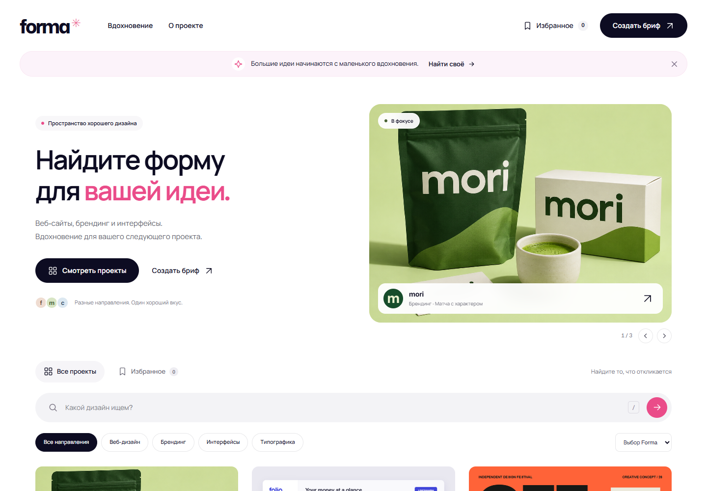
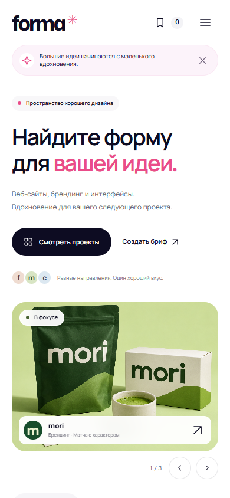

# FORMA

Русскоязычная галерея из шести авторских дизайн-концептов. Здесь можно рассмотреть упаковку матча **mori**, интерфейс финансового приложения **folio** или плакат **OFF GRID**, собрать понравившиеся работы в избранное и приложить подборку к брифу.

**[Открыть галерею FORMA в браузере](https://zxclunexxx.github.io/forma/dist/)**



[Вся страница целиком](previews/forma-fullpage.png)

<details>
<summary>Посмотреть мобильную версию</summary>



</details>

## Как пользоваться галереей

1. Найдите работы по названию, описанию или направлению. Фильтры переключают брендинг, веб-дизайн, интерфейсы и типографику. Проекты можно отсортировать по алфавиту или открыть случайный кнопкой «Мне повезёт».
2. Откройте карточку, чтобы прочитать о концепции. У каждой работы есть прямая ссылка, например `#project=mori`. Кнопка с закладкой добавляет её в избранное. Подборка сохраняется между посещениями в этом браузере.
3. Нажмите «Создать бриф», укажите задачу и срок. Выберите, включать ли избранные проекты. После проверки полей форма скачает бриф в формате TXT на ваше устройство.

На телефоне доступно компактное меню. Интерфейс поддерживает навигацию с клавиатуры и системную настройку уменьшения движения.

## Локальный запуск

Запустите сервер из корня репозитория с помощью Python 3.

```sh
python -m http.server 5173 --bind 127.0.0.1 --directory dist
```

Откройте [галерею в браузере](http://127.0.0.1:5173/). Для размещения на статическом хостинге достаточно содержимого папки `dist/`. Сайт работает на HTML, CSS и JavaScript, все изображения и шрифты загружаются локально. Поиск, избранное и подготовка брифа выполняются в браузере без внешнего API.

## Исходники и дизайн-набор

| Где искать | Что внутри |
| --- | --- |
| [dist/](dist/) | Разметка страницы и диалогов в `index.html`, адаптивные стили в `style.css`, каталог и поведение в `app.js`. В `assets/` находятся изображения, SVG и шрифты. |
| [dribbble-style/](dribbble-style/) | Разбор визуального языка главной страницы Dribbble. В `DESIGN.md` описаны типографика и композиция, в `tokens.json` собраны цвета, интервалы и скругления. Рядом лежат инструкция `SKILL.md`, скриншот референса и исходные замеры. |
| [previews/](previews/) | Скриншоты самой FORMA на компьютере и телефоне. |

## Визуальные материалы

Белый фон, тёмный текст `#0d0c22`, розовый акцент `#ea4c89`, широкие поля и кнопки-капсулы отсылают к Dribbble. Для латиницы используется Mona Sans, для кириллицы — Manrope. Оба шрифта распространяются по лицензии OFL. [Источники и лицензии шрифтов](dist/assets/fonts/)

Все шесть работ созданы для FORMA. Иллюстрация упаковки mori сгенерирована в ImageGen, остальные пять концептов нарисованы в SVG. [Промпт и происхождение mori](dist/assets/mori-provenance.md) · [Сведения обо всех иллюстрациях](dist/assets/credits.json)
